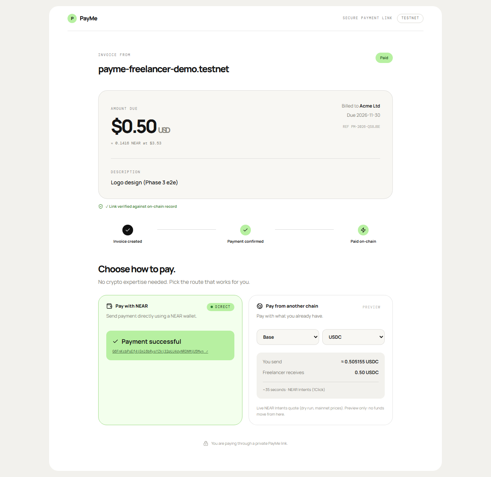
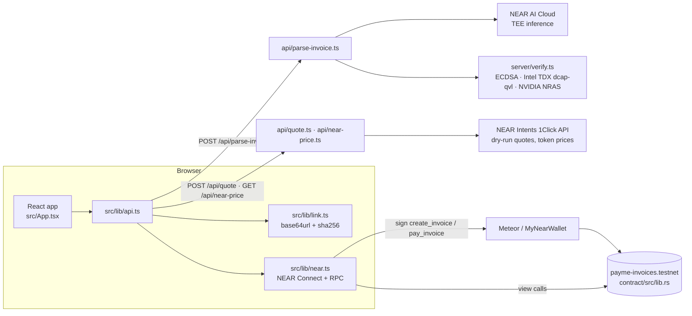

# PayMe

[](https://github.com/GoodnessTech/PayMe/actions/workflows/ci.yml)
[](LICENSE)
[](https://testnet.nearblocks.io/address/payme-invoices.testnet)

**PayMe turns a freelancer's invoice into a private payment link: NEAR AI Cloud reads the invoice inside a verified TEE, a NEAR smart contract records only a fingerprint and the amount, and the client pays on NEAR (with a live NEAR Intents cross-chain quote as a preview).**

| | |
|---|---|
| Live demo | **`LIVE_URL_PLACEHOLDER`** (Vercel) |
| Demo video | `DEMO_VIDEO_PLACEHOLDER` |
| Post on X | `X_POST_PLACEHOLDER` |
| Contract (testnet) | [`payme-invoices.testnet`](https://testnet.nearblocks.io/address/payme-invoices.testnet) |
| Evidence | [RESULTS.md](RESULTS.md) (transactions) · [docs/CLAIMS.md](docs/CLAIMS.md) (every claim → code/test/tx) · [docs/sample-attestation.json](docs/sample-attestation.json) |



## The problem

- Sending $200 into Sub-Saharan Africa costs around 8–9% on average, the most expensive region in the world ([World Bank, Remittance Prices Worldwide](https://remittanceprices.worldbank.org)).
- Crypto clients hold funds on many chains. Asking them to bridge to the freelancer's chain is a common reason payments stall.
- Pasting client invoices into ordinary AI tools sends private business data to servers you can't inspect.

## How it works

1. The freelancer pastes invoice text. `POST /api/parse-invoice` sends it to **NEAR AI Cloud**. The model runs in an Intel TDX + NVIDIA GPU TEE, and the server verifies the response signature and attestation (8 checks, below) before showing a green "TEE verified" badge.
2. The freelancer edits the draft and clicks **Create payment link**. The browser:
   - encodes the details into the link fragment (`/pay/{id}#{base64url JSON}`);
   - computes `sha256` of that JSON;
   - converts USD to NEAR at the live rate;
   - signs `create_invoice` on the **testnet contract** with their wallet (Meteor or MyNearWallet via NEAR Connect).

   Only the id, recipient, amounts, fingerprint and status go on-chain.
3. The client opens the link. The page decodes the fragment, recomputes the fingerprint and compares it with `get_invoice` from the chain. It shows **✓ Link verified against on-chain record**, or a red "Do not pay" warning if anything was altered.
4. The client pays with **Pay X NEAR**. `pay_invoice` forwards exactly the invoice amount to the freelancer and refunds any excess. If the forward fails, a callback refunds the payer and reopens the invoice.
5. Optionally, the client picks a chain and token (e.g. USDC on Base) to see a **live NEAR Intents 1Click quote**. It's a `dry: true` quote, because Intents only runs on mainnet.
6. The freelancer's dashboard lists their invoices from the contract (`get_invoices_by_recipient`). Client names appear only on the device that created the link.



## How NEAR is used

| NEAR technology | What PayMe does with it | Where |
|---|---|---|
| **NEAR AI Cloud** (private inference) | Extracts invoice fields with `Qwen/Qwen3-VL-30B-A3B-Instruct` in a TEE. Fetches the attestation report with a fresh nonce and the per-request signature, then runs 8 verification checks. | [`server/nearai.ts`](server/nearai.ts) `parseWithNearAi`, `verifyCompletion` · [`server/verify.ts`](server/verify.ts) · [`api/parse-invoice.ts`](api/parse-invoice.ts) |
| **NEAR Intents 1Click API** | Live `dry: true`, `EXACT_OUTPUT` quotes: "pay with token X on chain Y, freelancer receives exactly $N USDC on NEAR". Also the NEAR/USD price (wNEAR). | [`server/oneclick.ts`](server/oneclick.ts) `getDryQuote`, `buildQuoteRequest`, `findNearPrice` · [`api/quote.ts`](api/quote.ts) · [`api/near-price.ts`](api/near-price.ts) |
| **Smart contract** (Rust, near-sdk 5.30.1) | `create_invoice` (storage paid by caller, excess refunded), `pay_invoice` (forward + refund excess + `on_payout` callback), `get_invoice`, `get_invoices_by_recipient`, NEP-297 events. No admin. | [`contract/src/lib.rs`](contract/src/lib.rs) · tests in [`contract/src/tests.rs`](contract/src/tests.rs) · [`contract/README.md`](contract/README.md) |
| **Named accounts + wallets** | NEAR Connect (the connector docs.near.org recommends) with Meteor and MyNearWallet on testnet, plus FastNEAR RPC for view calls. | [`src/lib/near.ts`](src/lib/near.ts) · [`src/lib/api.ts`](src/lib/api.ts) |

### The 8 verification checks behind "TEE verified"

`verified` is `true` only if **all** of these pass ([`server/nearai.ts` `verifyCompletion`](server/nearai.ts)). The results are from a real request ([docs/sample-attestation.json](docs/sample-attestation.json)):

| # | Check | What it proves | Result |
|---|---|---|---|
| 1 | signature covers this request/response | The signed text is `model:sha256(our exact request bytes):sha256(the exact response bytes)` | ✓ |
| 2 | ECDSA signature valid | The EIP-191 signature recovers to the claimed signing address (`0x2665cce9…5462`) | ✓ |
| 3 | signer is in the attestation report | That address is the model TEE's attested signing key | ✓ |
| 4 | fresh nonce | The report echoes the random 32-byte nonce we sent for this request | ✓ |
| 5 | Intel TDX quote valid | `@phala/dcap-qvl` verifies the quote against Intel collateral: TCB `UpToDate`, not in debug mode | ✓ |
| 6 | report_data binding | The TDX `report_data` contains the signing address and our nonce | ✓ |
| 7 | app compose measured | MRCONFIGID = `0x01 ‖ sha256(app_compose)`, so the key belongs to the measured software | ✓ |
| 8 | NVIDIA GPU attestation | NVIDIA's NRAS says the GPU evidence (bound to our nonce) is valid | ✓ |

If NEAR AI Cloud isn't configured or fails, a **local regex parser** is used instead. Its response says `verified: false`, provider `"Local fallback (NEAR AI Cloud unavailable)"`, and the UI shows an amber **"Local fallback: not private"** badge, never the green one.

## Privacy model

| Data | Where it lives | Who can see it |
|---|---|---|
| Client name, description, due date | The payment link **fragment** (after `#`), plus `localStorage` on the creator's device for their dashboard | Whoever holds the link. Browsers never send the fragment to servers. |
| Invoice text while it's being parsed | Sent once to `/api/parse-invoice`, then to NEAR AI Cloud's attested TEE | PayMe's function handles it in memory only. It is never stored or logged (tested). |
| id, recipient, amount (yoctoNEAR + USD cents), fingerprint, status, timestamps, payer | NEAR testnet contract state | Public, like any on-chain data |
| Quote request: USD amount, chain, token | Sent to the 1Click API | NEAR Intents (no invoice details) |
| PayMe server database | **None.** There is no database. | — |

## Try it in 3 minutes (live demo)

Open **`LIVE_URL_PLACEHOLDER`**. You need a NEAR testnet account in Meteor or MyNearWallet for steps (b) and (e); [create one free](https://testnet.mynearwallet.com).

| Do | See |
|---|---|
| **(a)** `/new`: keep the sample text, change the amount to `$5`, click **Read with private AI** | Fields filled in and a green **Processed privately — TEE verified** badge. **View proof** shows the model, signing address, signature and "8/8 passed". |
| **(b)** Clear **NEAR recipient** (it defaults to your wallet), then **Create payment link**, choose your wallet and approve | "Your payment link is ready" with a QR code and "Recorded on-chain · X NEAR at $Y · View transaction ↗" |
| **(c)** Open the link in an incognito window | Invoice details and **✓ Link verified against on-chain record**. Change one character after `#` and you get a red "Do not pay" warning instead. |
| **(d)** Under **Pay from another chain**, click **Preview route** (try Base/USDC, then Bitcoin/BTC) | A live NEAR Intents quote: "You send ≈ … · Freelancer receives 5.00 USDC · ~35 seconds" |
| **(e)** **Connect NEAR wallet**, then **Pay X NEAR**, using a second testnet account | **Payment successful** with a link to the transaction on testnet.nearblocks.io. `/dashboard` shows the invoice as **paid**. |

Screenshots: [create + TEE badge](docs/screenshots/create-verified.png) · [proof modal with 8 checks](docs/screenshots/proof-modal.png) · [verified + paid + quote](docs/screenshots/pay-verified-paid.png) · [tampered link](docs/screenshots/pay-tampered.png) · [landing](docs/screenshots/home.png). Placeholder for the deployed site: `docs/screenshots/live-demo.png` (to be added).

## For judges: verify in 5 minutes

No keys or `.env` needed. Requires Node 22.12+ (24 recommended, see `.nvmrc`); Rust only for the contract step.

```bash
git clone https://github.com/GoodnessTech/PayMe.git && cd PayMe
npm ci
```

| Run | Expect |
|---|---|
| `npm test` | `Test Files  6 passed (6)` · `Tests  45 passed (45)`. Every external call is mocked. |
| `npm run typecheck && npm run lint && npm run build` | No errors; `✓ built in …` |
| `npm run verify:sample` | 4× `PASS`, ending `Sample attestation re-verified offline.` This recovers the TEE signer from the real signature in `docs/sample-attestation.json`. |
| `npm run invoice -- PM-2026-V2PN6V` | Reads the contract over public RPC: `Paid: 1.43266 NEAR for $5.00 to payme-freelancer-demo.testnet, paid by payme-client-demo.testnet` |
| `npm run contract:test` (Rust via [rustup](https://rustup.rs); `contract/rust-toolchain.toml` pins 1.99.1) | `test result: ok. 25 passed; 0 failed` |
| `npm run dev`, then open the link below | `http://localhost:5173` starts with no `.env` |

With `npm run dev` running, call the API (macOS/Linux shell; on Windows PowerShell use `curl.exe`):

```bash
curl http://localhost:5173/api/near-price
# {"usd":3.5,"source":"NEAR Intents 1Click token list (wNEAR)","fetchedAt":"…","priceUpdatedAt":"…"}

curl -X POST http://localhost:5173/api/quote -H "Content-Type: application/json" -d '{"amountUsd":25,"chain":"Base","token":"USDC"}'
# {"originChain":"Base","originToken":"USDC","amountIn":"25.2…","amountOutUsdc":"25.00","etaSeconds":35,"route":"NEAR Intents (1Click)","preview":true}

curl -X POST http://localhost:5173/api/parse-invoice -H "Content-Type: application/json" -d '{"text":"Invoice to Acme Ltd for logo design, $250, due November 30, 2026. Payment to tunde.testnet."}'
# without NEAR_AI_API_KEY: "verified":false,"provider":"Local fallback (NEAR AI Cloud unavailable)"
# with a key in .env: "verified":true plus "proof" with all 8 checks
```

Then open this real, already-paid invoice in your browser. The link itself carries the invoice details:

`http://localhost:5173/pay/PM-2026-QS8JBE#eyJpZCI6IlBNLTIwMjYtUVM4SkJFIiwiY2xpZW50TmFtZSI6IkFjbWUgTHRkIiwiZGVzY3JpcHRpb24iOiJMb2dvIGRlc2lnbiAoUGhhc2UgMyBlMmUpIiwiYW1vdW50VXNkIjowLjUsImR1ZURhdGUiOiIyMDI2LTExLTMwIiwicmVjaXBpZW50IjoicGF5bWUtZnJlZWxhbmNlci1kZW1vLnRlc3RuZXQiLCJjcmVhdGVkQXQiOiIyMDI2LTExLTEzVDA5OjAwOjUzLjkwOFoifQ`

You should see "Billed to Acme Ltd", **✓ Link verified against on-chain record**, "≈ 0.1416 NEAR at $3.53", **Paid**, and a link to its payment transaction (or "Paid by payme-client-demo.testnet" if the nearblocks indexer is unreachable). Change any character after `#` and the page shows the red "Do not pay" warning.

Then check each claim against the code: [docs/CLAIMS.md](docs/CLAIMS.md) maps every claim in this README to a file and function, a test, or an on-chain transaction. Repo guide for agents: [CLAUDE.md](CLAUDE.md) / [AGENTS.md](AGENTS.md).

## Run locally (Windows, macOS, Linux)

**Prerequisites:**
- Node 22.12+ (24 recommended, `nvm use` reads `.nvmrc`) and npm.
- For the contract only:
  - Rust via rustup (the toolchain is pinned in `contract/rust-toolchain.toml`);
  - on Windows, Visual Studio Build Tools with "Desktop development with C++";
  - [cargo-near](https://github.com/near/cargo-near) and [near-cli-rs](https://github.com/near/near-cli-rs) to build and deploy.

```bash
npm ci
cp .env.example .env          # optional; Windows: copy .env.example .env
npm run dev                   # → VITE ready, Local: http://localhost:5173/  (frontend + /api in one process)
```

| Command | What it does | Expected |
|---|---|---|
| `npm run dev` | Vite dev server plus the `/api` functions (a small Vite plugin, [`vite-api-plugin.ts`](vite-api-plugin.ts)). No Vercel login. | `Local: http://localhost:5173/` |
| `npm test` | Vitest unit tests (no network, no keys) | `45 passed` |
| `npm run typecheck` / `npm run lint` / `npm run build` | TS for app + API + config / ESLint / production build to `dist/` | no errors |
| `npm run contract:test` | `cargo test` in `contract/` | `25 passed` |
| `npm run contract:build` | `cargo near build non-reproducible-wasm --no-abi` | `contract/target/near/payme_contract.wasm` (~154 KB) |
| `npm run contract:deploy` | Build, then deploy to `VITE_CONTRACT_ID` with near-cli-rs (legacy keychain, testnet only) | `Contract code has been successfully deployed.` |

### Environment variables

All are optional for local development. `.env` is gitignored; see [`.env.example`](.env.example).

| Variable | Used by | What it does | Default if unset |
|---|---|---|---|
| `NEAR_AI_API_KEY` | server only | NEAR AI Cloud key (`sk-…`) for TEE parsing and verification | Labelled local regex fallback, `verified: false` |
| `NEAR_AI_MODEL` | server only | Model id for extraction | `Qwen/Qwen3-VL-30B-A3B-Instruct` |
| `INTENTS_QUOTE_RECIPIENT` | server only | An **existing mainnet** NEAR account, used only as the recipient of dry-run quotes (1Click rejects non-existent accounts). Nothing is ever sent to it. | `intents.near` |
| `ONECLICK_JWT` | server only | Optional 1Click partner JWT. Without it, quotes include an extra 0.25% fee. | none |
| `VITE_CONTRACT_ID` | browser (build time) | PayMe contract on testnet | `payme-invoices.testnet` |
| `VITE_NEAR_NETWORK` | browser (build time) | Must be `testnet`; the app refuses anything else | `testnet` |

## Deploy your own

[](https://vercel.com/new/clone?repository-url=https%3A%2F%2Fgithub.com%2FGoodnessTech%2FPayMe&project-name=payme&repository-name=payme&env=NEAR_AI_API_KEY%2CNEAR_AI_MODEL%2CINTENTS_QUOTE_RECIPIENT%2CVITE_CONTRACT_ID%2CVITE_NEAR_NETWORK&envDefaults=%7B%22NEAR_AI_MODEL%22%3A%22Qwen%2FQwen3-VL-30B-A3B-Instruct%22%2C%22INTENTS_QUOTE_RECIPIENT%22%3A%22intents.near%22%2C%22VITE_CONTRACT_ID%22%3A%22payme-invoices.testnet%22%2C%22VITE_NEAR_NETWORK%22%3A%22testnet%22%7D&envDescription=NEAR%20AI%20Cloud%20API%20key%20%28sk-...%29%2C%20model%20id%2C%20an%20existing%20mainnet%20NEAR%20account%20used%20only%20as%20the%20recipient%20of%20dry-run%20quotes%2C%20and%20the%20PayMe%20testnet%20contract.&envLink=https%3A%2F%2Fgithub.com%2FGoodnessTech%2FPayMe%23environment-variables)

1. Click the button and sign in to Vercel (the free Hobby plan is enough).
2. Fill in the variables. The four non-secret ones are prefilled; only `NEAR_AI_API_KEY` needs your own value.

   | Variable | Value |
   |---|---|
   | `NEAR_AI_API_KEY` | your NEAR AI Cloud key (`sk-…`) |
   | `NEAR_AI_MODEL` | `Qwen/Qwen3-VL-30B-A3B-Instruct` |
   | `INTENTS_QUOTE_RECIPIENT` | `intents.near` (or your own mainnet account) |
   | `VITE_CONTRACT_ID` | `payme-invoices.testnet` (or your own deployment) |
   | `VITE_NEAR_NETWORK` | `testnet` |

3. Click **Deploy**.

[`vercel.json`](vercel.json) sets:
- the Vite framework preset;
- an SPA rewrite, so `/pay/:id` and `/dashboard` survive a refresh (`/api/*` is excluded);
- `maxDuration` of 60 s for `parse-invoice` (normally about 7–15 s with verification) and 20 s for the other two functions, well within the Hobby limit.

CI runs a real `vercel build` on Linux and calls the three built functions ([`scripts/check-vercel-build.mjs`](scripts/check-vercel-build.mjs)). Wallet popups use `window.location`, so any domain works and nothing is hard-coded to localhost.

## Tests

| Suite | Count | Covers |
|---|---|---|
| [`server/verify.test.ts`](server/verify.test.ts) | 12 | Signed-text format, EIP-191 recovery, report_data and compose binding, and `verifyCompletion`: verified only when all checks pass, with failures for tampered response, wrong signer, signer not attested, stale nonce, bad or debug TDX quote, revoked TCB, failed GPU check and unknown signature kind. NRAS is mocked. |
| [`server/oneclick.test.ts`](server/oneclick.test.ts) | 12 | UI chain/token → real 1Click asset ids, clear 400 for missing combos, exact unit conversion, dry-run request shape, response mapping, token caching, JWT header. `fetch` is mocked. |
| [`server/invoice.test.ts`](server/invoice.test.ts) | 9 | Fallback parser on the UI examples, sanitising untrusted model output, date normalisation, `.testnet` account rules |
| [`server/parse-invoice.test.ts`](server/parse-invoice.test.ts) | 3 | Labelled fallback with no key, fallback on API failure **without logging invoice text**, input validation (400/403/415) |
| [`src/lib/link.test.ts`](src/lib/link.test.ts) | 4 | Link encoding round-trip, fingerprint matches a real on-chain record, damaged links rejected |
| [`src/lib/chain.test.ts`](src/lib/chain.test.ts) | 5 | USD→yoctoNEAR, rate recovery, link vs chain mismatch detection, friendly wallet/RPC errors |
| [`contract/src/tests.rs`](contract/src/tests.rs) | 25 | Every method and every rejection: duplicate id, empty, oversized or invalid ids, bad fingerprint, zero amounts, missing storage deposit, underpayment, paying twice, unknown invoice. Also the excess and storage refunds, payout callback success and failure, pagination. |
| CI `vercel-build` job | — | Real `vercel build`, then calls each built function with no keys |

Live testnet evidence (create → pay → read, overpayment refund, double-pay rejection, private callback) is in [RESULTS.md](RESULTS.md).

## Known limitations

- **Cross-chain payments are previews only.** NEAR Intents runs on mainnet, and this project is zero-cost and testnet-only, so the "Pay from another chain" card shows real `dry: true` 1Click quotes but executes nothing. Real payments in PayMe are **testnet NEAR** via the contract.
- **NVIDIA attestation:** we send the GPU evidence to NVIDIA's NRAS over HTTPS and read its result, but we don't independently verify the signature of NRAS's JWT.
- **Intel TDX:** quotes are cryptographically verified with `dcap-qvl`, with collateral from Phala's PCCS mirror. "Out of date" TCB statuses still pass, matching the official NEAR AI verifier, and the status is shown in the proof (currently `UpToDate`). We check that the signing key is bound to the measured app compose, but we don't audit what that compose or the model weights contain.
- **Not audited.** The smart contract is unaudited and runs on testnet.
- **Dashboard client names** show only on the device that created the link, by design. Other devices see "Private invoice", because names are never stored on a server or on-chain.
- **Exchange rate.** The NEAR amount is fixed when the invoice is created, using the live NEAR/USD price from 1Click's wNEAR entry (a mainnet market price applied to testnet NEAR).
- **MyNearWallet on testnet.** NEAR Connect's public wallet list doesn't flag MyNearWallet as testnet-capable, although its official wallet script supports `testnet.mynearwallet.com`. [`src/lib/near.ts`](src/lib/near.ts) sets that flag; the wallet code is unchanged.
- **Transaction hashes** aren't stored on-chain. Other devices find the payment transaction through the nearblocks indexer, for display only (best effort).
- **No sandbox integration tests.** `near-sandbox` doesn't support Windows, where this was built. Coverage comes from unit tests plus real testnet transactions.
- **The fallback parser** is a simple regex parser for when NEAR AI Cloud is unavailable. It is labelled as such and never marked verified.

## Built for the NEAR hackathon

- **Tracks:** Real-World Money · Privacy & Private AI.
- **Built Nov 12–14, 2026.**
  - The frontend design was generated with **Bolt.new**.
  - The backend, verification, smart contract, wallet wiring and tests were written with **Claude Code** (AI-assisted), reviewed and tested by the author.
  - The build log is in [docs/BUILD_LOG.md](docs/BUILD_LOG.md).
- **Main libraries:**
  - Frontend: React 18, Vite 7, Tailwind, `@hot-labs/near-connect`.
  - Server: `ethers` (EIP-191 recovery), `@phala/dcap-qvl` (Intel TDX quotes).
  - Contract: `near-sdk` 5.30.1 (Rust).
  - Tests: Vitest.

## Repository layout

```
api/                 Vercel functions (one file = one endpoint): parse-invoice, quote, near-price
server/              Shared server code + tests: NEAR AI Cloud client, verification, 1Click client, parser
src/App.tsx          All UI pages (Bolt design): landing, /new, /pay/:id, /dashboard
src/lib/             api.ts (the only data layer), near.ts (wallet + RPC), link.ts, chain.ts
contract/            Rust smart contract (near-sdk) + unit tests + README
scripts/             deploy-contract, get-invoice, verify-sample-attestation, check-vercel-build
docs/                CLAIMS.md, BUILD_LOG.md, sample-attestation.json, screenshots/
vite-api-plugin.ts   Serves /api from the Vite dev server (npm run dev)
```

## License

[MIT](LICENSE) © 2026 Goodness Tublas
